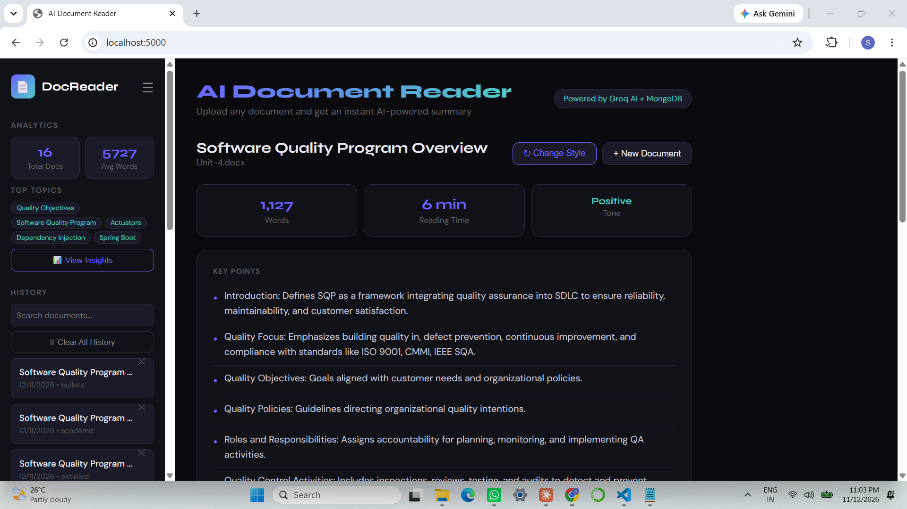
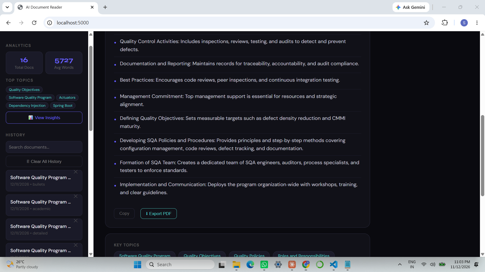
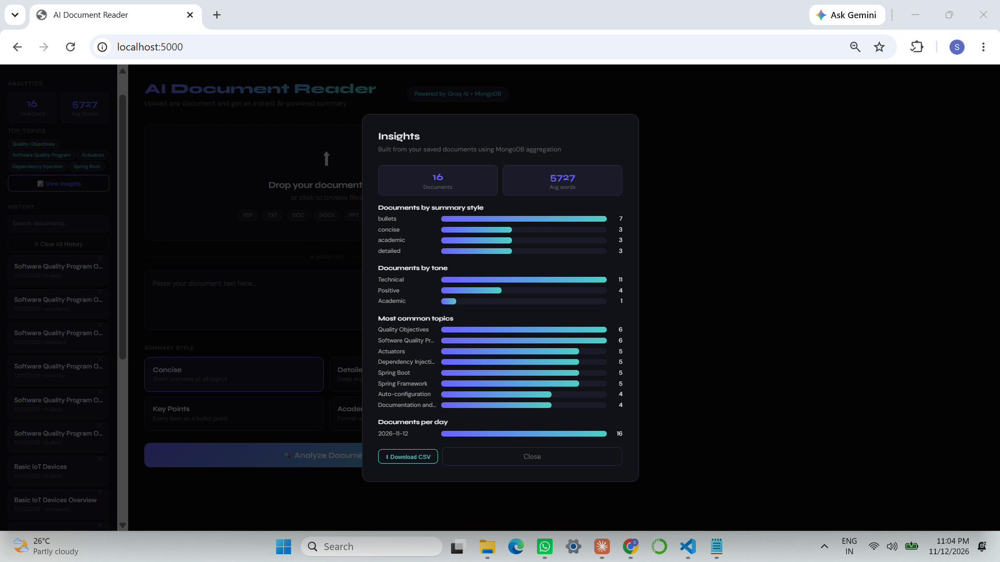
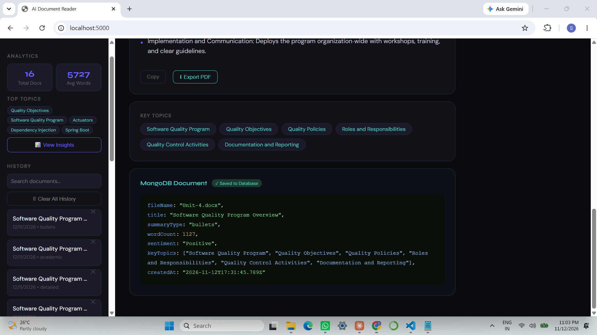

# AI Document Reader

Upload a **PDF, DOCX, PPTX, TXT or MD** file (or paste text), choose a summary style, and get an AI summary, key topics, tone, word count and reading time. Every result is stored in **MongoDB**, giving you searchable history, an **Insights** view built from aggregation pipelines, and a **CSV export** for Excel / Power BI / Tableau.

Course project for *Data Modeling with NoSQL Databases* (JAIN Deemed-to-be University), extended with automated tests and an analytics view.

## Screenshots

**Summary (Key Points style)**



**Full output**



**Insights built from MongoDB aggregation**



**Every result is saved as a MongoDB document**




## Features
- Text extraction from PDF, DOCX, PPTX and plain text
- 4 summary styles: concise, detailed, key points, academic
- Word count and reading time **measured by the server** (not guessed by the AI)
- Automatic **retry** when the AI provider rate-limits, plus clear error messages
- **Insights** panel: documents by style, by tone, top topics and documents per day
- **Change style** on any saved document without re-uploading (the text sent to the AI is stored with the record)
- **CSV export** of all saved documents
- `/api/health` endpoint and an automated test suite (`npm test`)

## Stack
Node.js · Express · MongoDB (Mongoose) · Groq API (`openai/gpt-oss-120b`) · vanilla HTML/CSS/JS

## How it works
```
Browser (frontend/app.js)
   │  POST /api/summarize  (multipart: file + summaryType)
   ▼
Express (backend/server.js)
   │  multer keeps the file in memory → extractText() picks a parser by extension
   │  (pdf2json · mammoth · unzipper for PPTX slide XML · plain UTF-8)
   │  server counts words / reading time
   │  builds a style-specific prompt → Groq chat completion (JSON only, auto-retry on rate limit)
   │  validates the JSON → saves a Document in MongoDB
   ▼
MongoDB  ← /api/history, /api/analytics, /api/export.csv read it back
```

## Data model (`backend/documentModel.js`)
| Field | Type | Notes |
|---|---|---|
| fileName, fileType, fileSize | String | file metadata |
| originalText | String | first 500 chars (preview) |
| sourceText | String | text sent to the AI; hidden from normal queries (`select: false`), used by change style |
| summaryType | String | concise / detailed / bullets / academic |
| summary, title | String | AI output |
| wordCount, readingTime | Number | measured by the server |
| sentiment | String | tone label |
| keyTopics | [String] | embedded array (no join table needed) |
| createdAt | Date | default now, indexed (newest first) |

## Analytics (MongoDB aggregation pipelines)
`GET /api/analytics` returns, all computed in the database:
- documents per summary style → `$group` + `$sum`
- documents per tone → `$group` + `$sum`
- average length → `$group` + `$sum` of word counts ÷ document count
- most common topics → `$unwind` + `$group` + `$sort` + `$limit`
- documents per day → `$group` with `$dateToString`

## API
| Method | Route | Purpose |
|---|---|---|
| POST | `/api/summarize` | upload file or text, returns summary and saves it |
| GET | `/api/history` | latest 20 documents |
| POST | `/api/history/:id/resummarize` | re-summarize a saved document in another style (no re-upload) |
| DELETE | `/api/history/:id` | delete one |
| DELETE | `/api/history` | clear all |
| GET | `/api/analytics` | aggregated statistics |
| GET | `/api/export.csv` | all documents as CSV |
| GET | `/api/health` | server, database and AI-key status |

## Run locally
```bash
git clone <your-repo-url> && cd ai-document-reader
npm install
cp .env.example .env      # then fill in MONGODB_URI and GROQ_API_KEY
npm start                 # open http://localhost:5000
```
Free MongoDB cluster: mongodb.com/atlas · free Groq key: console.groq.com. **Never commit `.env`.**

## Test it
```bash
npm test
```
Runs 15 automated checks (all four file types, word count, empty input, change style, rate-limit retry, friendly errors, analytics, CSV export, delete). It uses a **separate test database** (`docreader_test`) and a fake local AI server, so it never touches your real data or spends API tokens.

Quick manual check before a demo: `npm start` → upload one file of each type → confirm it appears in History → open **View Insights**.

## Troubleshooting
| Message | Meaning | Fix |
|---|---|---|
| "The AI service is busy" | Free-tier tokens-per-minute limit | Wait about a minute (the app already retries short waits) |
| "The configured AI model is unavailable" | Provider retired the model | Set `GROQ_MODEL` in `.env` to a current model |
| "bad auth" at startup | Wrong MongoDB user or password | Re-check `MONGODB_URI`; use a password with only letters and numbers |
| `injected env (0)` | `.env` is missing or empty | Create `.env` (not `.env.example`) |

## Limits
Files up to 10 MB. Only the first 4,000 characters (`MAX_INPUT_CHARS`) are sent to the model to stay inside free-tier limits, so long documents are summarized from their opening section. Legacy `.ppt` is not supported (convert to `.pptx`). Scanned PDFs (images) need OCR and are not supported.

## Ideas for next steps
Chunked summarization for long documents · user login with per-user history · OCR for scanned files · server-side search with a text index.
